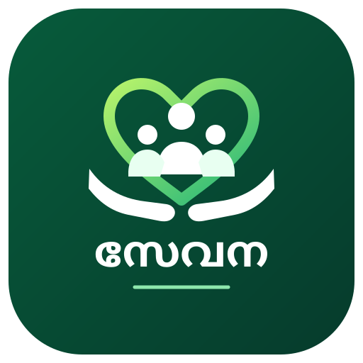

# 💚 Sevana — Local Services Platform

<p align="center">
  
</p>

<h3 align="center">സേവന — നാടിനായി, നാട്ടുകാർക്കായി.</h3>

<p align="center">
  A community-focused platform connecting people with essential local services.
</p>

<p align="center">
  
  
  
  
</p>

<p align="center">
  <a href="https://sevana.vercel.app/">Visit Sevana</a>
  ·
  <a href="https://sevana.vercel.app/admin">Admin Panel</a>
</p>

---

## 🌿 About Sevana

**Sevana (സേവന)** is a local services platform developed to make essential community services easier to discover and access.

Created for the community of **Meenarkuzhi, Malappuram, Kerala**, Sevana brings useful local information together in one accessible platform.

From finding blood donors to contacting local workers and transportation providers, the goal is simple: make getting help easier.

### Our Mission

> Connecting people, supporting the community, and making local services more accessible through technology.

---

## ✨ Key Services

<table>
  <tr>
    <td width="50%">
      <h3>🩸 Find Blood Donors</h3>
      Discover registered blood donors and help connect people who need blood with potential donors.
    </td>
    <td width="50%">
      <h3>🚨 Emergency Hotlines</h3>
      Access important local contact information, including hospitals, ambulance services, police and other emergency contacts.
    </td>
  </tr>
  <tr>
    <td width="50%">
      <h3>🚕 Taxi & Transport</h3>
      Find local taxi, auto, tourist bus and rental transport contacts.
    </td>
    <td width="50%">
      <h3>🛠️ Local Workers</h3>
      Find local service providers for plumbing, electrical work, repairs, construction and painting.
    </td>
  </tr>
</table>

---

## 📱 Progressive Web App

Sevana is designed as a Progressive Web App (PWA), with an app-like experience on supported devices.

- 📲 Installable on supported devices and browsers
- ⚡ Responsive, mobile-first interface
- 🎨 Clean green-and-white visual identity
- 🧭 Easy access to local services
- 🔄 Service Worker and caching support
- 📱 Dedicated application icons

*Installation and offline behavior depend on the implemented configuration and browser support.*

---

## 🛡️ Administration

Sevana includes a dedicated administration area intended for managing platform data and services.

**Admin Panel:** [sevana.vercel.app/admin](https://sevana.vercel.app/admin)

Administration features may include:

- Managing local service information
- Reviewing donor registrations and blood requests
- Maintaining hotline and transport details
- Managing worker listings
- Reviewing submitted information

*Only features implemented and properly secured in the deployed application should be considered available. Administrative access must be protected by authentication and appropriate database permissions.*

---

## 🧰 Technology Stack

| Technology | Purpose |
|---|---|
| Next.js | Application framework |
| TypeScript | Type-safe development |
| Supabase | Database and backend services |
| PostgreSQL | Relational data storage |
| PWA | Installable web application |
| Vercel | Application deployment |

---

## 🚀 Getting Started

### Prerequisites

- Node.js
- npm
- A Supabase project
- Git

### 1. Clone the repository

```bash
git clone YOUR_GITHUB_REPOSITORY_URL
cd YOUR_PROJECT_FOLDER
```

Replace the placeholders with your actual repository URL and project directory.

### 2. Install dependencies

```bash
npm install
```

### 3. Configure environment variables

Create a `.env.local` file in the project root.

```env
NEXT_PUBLIC_SUPABASE_URL=your_supabase_project_url
NEXT_PUBLIC_SUPABASE_ANON_KEY=your_supabase_publishable_key
```

Use the environment variable names expected by your existing Supabase client configuration. Never expose a Supabase secret or service-role key in browser-side code or commit secrets to GitHub.

### 4. Apply the directory upgrade in Supabase

Before deploying this update, open **Supabase Dashboard → SQL Editor** and run the migration file:

`supabase/migrations/20261013_service_categories_upgrade.sql`

This adds KSEB, Goods & Lorry, and the new Local Workers categories. It also maps existing Construction, Painting, and Repair listings into the closest new worker categories so existing entries are retained. The admin drag-and-drop order uses `sort_order`; if it has not been applied to your project yet, also run `supabase/migrations/20261012_listing_order.sql`.

### 5. Start the development server

```bash
npm run dev
```

Open [http://localhost:3000](http://localhost:3000) in your browser.

### 6. Create a production build

```bash
npm run build
npm run start
```

---

## 📂 Project Structure

The following is an example structure. Adapt it to match the actual repository.

```text
sevana/
├── public/
│   ├── sw.js
│   ├── manifest.json
│   ├── admin-manifest.json
│   ├── sevana-icon.svg
│   └── sevana-admin-icon.svg
├── src/
│   └── app/
│       ├── layout.tsx
│       ├── page.tsx
│       └── admin/
│           ├── layout.tsx
│           └── page.tsx
├── .env.local
├── package.json
└── README.md
```

---

## 🔐 Privacy & Security

Sevana is intended to support responsible access to community service information.

- Protect administrative routes and operations.
- Configure Supabase Row Level Security (RLS) for database tables.
- Collect personal information only when necessary.
- Obtain appropriate consent before publishing donor contact information.
- Keep emergency contact details accurate and up to date.
- Never commit credentials or private environment files to version control.

Blood donation information is not a substitute for medical advice or professional medical care. Donation eligibility and suitability must be confirmed by qualified healthcare professionals.

---

## 🤝 Community

Sevana aims to support a more connected and helpful local community.

Community members can contribute by sharing accurate service information, reporting outdated contact details and helping improve the platform.

---

## 🗺️ Roadmap

- [ ] Verify and improve all service listings
- [ ] Complete security and access-control testing
- [ ] Test installation on Android and iOS browsers
- [ ] Improve accessibility and Malayalam language support
- [ ] Conduct real-device testing with community members
- [ ] Launch and collect user feedback

---

## 💚 Built for the Community

<p align="center">
  <strong>സേവന</strong><br/>
  <em>Technology with a purpose. Service with care.</em>
</p>

<p align="center">
  <a href="https://sevana.vercel.app/">Explore Sevana</a>
</p>
